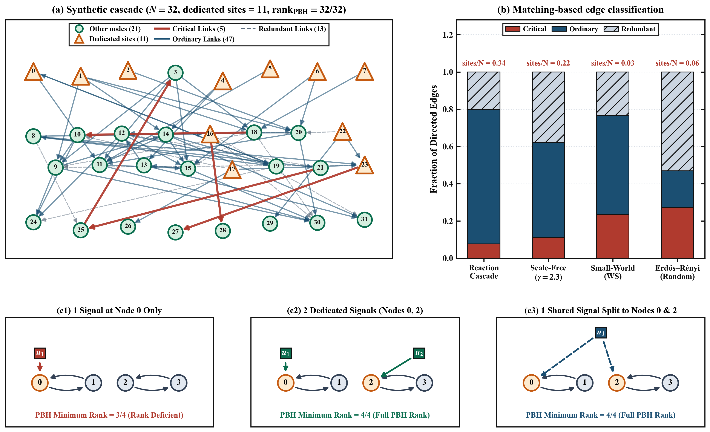
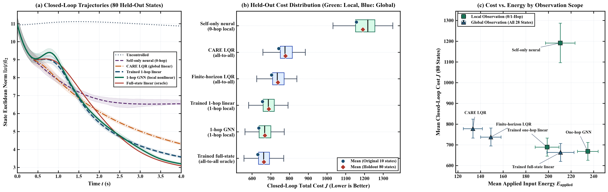

# NetControl-Pinning-Lab

一个可复跑的复杂网络控制实验。给定一张有向图，应该把控制信号接在哪里？在固定时间内，要花多少输入能量才能到达指定目标？当控制器只能看到邻居时，图神经网络能比线性反馈多做什么？下面分别用 32、30、28 节点的合成网络回答这三个问题。仓库同时提供图生成器、数值算法、交互工作台和逐次实验记录。

## 驱动节点与独立输入通道

**执行器位置**是实际接收控制的节点。专用接线给每个位置分配一路独立信号，共享接线允许一路信号以各自的增益送到多个位置。这对应输入矩阵 $`B`$ 的非零行和列两个不同的计数。

在非空图的一般结构模型中，令 $`m=N-\lvert M^*\rvert`$ 为最大匹配的缺额。允许分接时，最少独立信号数为 $`\max(1,m)`$。要求每个位置各接一路时，还要覆盖每个没有外来边的强连通分量。若共有 $`\beta`$ 个这样的分量，且最大匹配的右侧未匹配节点至多能覆盖其中 $`\alpha`$ 个，则最少专用位置数为 $`m+\beta-\alpha`$。实现先最大化匹配大小，再最大化这类分量的覆盖数。[结构算法与 PBH 检验](netcontrol/structural.py) · [专用执行器选址的理论依据](https://doi.org/10.1109/TAC.2015.2437525)

**两个互不相连的双向环**最容易看出区别。节点 0、1 构成一环，2、3 构成另一环。在同一组网络边权上，改变接线后得到以下 PBH 最小秩。

| 接线 | 接触节点数 | 独立信号数 | PBH 最小秩 |
| --- | ---: | ---: | ---: |
| 只有节点 0 接收输入 | 1 | 1 | 3/4 |
| 节点 0 和 2 各接一路 | 2 | 2 | 4/4 |
| 同一路信号分接节点 0 和 2 | 2 | 1 | 4/4 |

32 节点、65 条边的合成级联图中，最大匹配大小为 21。这里两个计数恰好都是 **11**，给选出的 11 个位置各接一路，PBH 最小秩为 **32/32**。边按删除后独立信号需求是否增加、以及能否进入最大匹配，分为 5 条关键边、47 条普通边和 13 条冗余边。PBH 使用图的原始稀疏结构和固定种子抽取的一组非零权重。后两项轨迹实验另行构造带衰减的数值系统。[接线、最大匹配与逐边分类](results/benchmark_summary.json)



度分布实验对三类 120 节点网络分别采样，每个目标平均出度各取五张图。图中纵轴为允许分接时的最少独立信号数占比，阴影为五张图之间的一个标准差。以目标平均出度 4 为例，ER 随机图观测均值为 **3.00%**，虚线 $`\exp(-4/2)`$ 为 **13.53%**。这组有限样本能展示不同生成器的差异，对该指数公式的定量拟合较差。[各图种子、边数和两种输入计数](results/benchmark_summary.json)


## 执行器选点、输入能量与终点误差

在固定的 30 节点线性系统上，以同一初态在 $`T=2`$ 时到达零为目标。比较 6 种执行器预算和 5 种选点策略。贪心选点最大化归一化格拉姆矩阵体积指标 $`\log\det(I+W/\epsilon)`$（$`\epsilon=10^{-5}`$）。基数约束下的 $`1-1/e`$ 近似保证适用于该体积指标。输入能量需要结合初态、目标和允许误差另行计算。[格拉姆矩阵与轨迹实现](netcontrol/gramian_lqr.py) · [子模体积指标](https://doi.org/10.1109/TCNS.2015.2453711)

给定接线后，令 $`E=\int_0^T\lVert u(t)\rVert_2^2\,dt`$ 为施加的输入能量，$`r=\lVert x(T)-x_f\rVert_2`$ 为终点误差。下表固定 $`K=10`$，各方法都求使 $`J_\lambda=E+r^2/\lambda`$ 最小的连续输入（$`\lambda=10^{-4}`$）。最后一列单独求解终点误差为零的问题。所有输入都没有幅值约束。

| 选点策略 | 可达维数 / 30 | 输入能量 $`E`$ | 终点误差 $`r`$ | 含惩罚总代价 | 精确到零的最小能量 |
| --- | ---: | ---: | ---: | ---: | ---: |
| 体积贪心 | 30 | 389.94 | 0.1846 | 730.76 | 1724.63 |
| 加权出度 | 24 | 127.16 | 0.4524 | 2173.55 | 该初态不可达零 |
| 反向图 PageRank | 24 | 339.38 | 0.4549 | 2409.00 | 该初态不可达零 |
| 介数 | 23 | 112.67 | 0.5357 | 2982.53 | 该初态不可达零 |
| 随机选点（固定种子） | 26 | 282.17 | 0.4617 | 2413.46 | 该初态不可达零 |

**旧表的 730.76 包含 389.94 输入能量和 340.82 终点惩罚。** 若给不同方法相同的终点误差上限，再比较各自所需最小能量，排名会随精度要求变化。

| 允许的最大终点误差 | 体积贪心 | 加权出度 |
| --- | ---: | ---: |
| 0.45 | **38.06** | 151.15 |
| 0.50 | 29.74 | **25.88** |

在这张图和这组预算中，贪心的优势是可达维数更高、精确到零可行。是否省能取决于目标精度。$`K=10`$ 时，CELF 惰性贪心和逐一计算边际增益的贪心选出相同序列，分别评估 72、255 次。所有 30 组运行均保存了节点列表、终态、秩判定容差与等误差对照。[系统矩阵、初态与逐次结果](results/benchmark_summary.json)


调用 `minimum_energy_trajectory` 时，`input_energy` 和兼容键 `energy` 均返回输入积分。读取旧版含惩罚数值请用 `regularized_objective`。`exact_target_energy` 在目标超出数值可达子空间时返回 `None`。设置 `reg=0` 表示要求精确终点，指定不可达目标会报错。[解析算例及数值积分回归测试](tests/test_energy_accounting.py)

## 非线性牵制控制的同图对照

同一张 28 节点合成图上，使用 8 个固定执行器、8 个训练初态，并给每个可学习控制器 55 轮训练。原 10 个和追加的 80 个留出初态来自同一个均匀分布，种子分别为 9090、16219。训练完成后冻结权重。下表各控制器使用相同的执行器和输入幅值上限 6。局部线性反馈和单跳 GNN 都可读取本节点及相邻节点，全状态线性反馈可以读取全部 28 个状态。自节点神经对照保留静态节点特征，用相同参数初始化，移除邻居消息后单独训练。[训练、观测掩码与对照定义](scripts/neural_pinning_comparison.py)

| 控制器 | 原 10 个初态平均 $`J`$ | 新 80 个初态平均 $`J`$ | 新 80 个初态平均施加能量 |
| --- | ---: | ---: | ---: |
| 稳态 CARE-LQR | 742.71 | 778.14 | 133.28 |
| 带终端权重的有限时域 LQR | 704.30 | 737.78 | 149.13 |
| 学习得到的局部线性反馈 | 655.95 | 689.29 | 198.86 |
| 学习得到的全状态线性反馈 | **630.86** | **663.42** | 210.69 |
| 仅看本节点的神经控制器 | 1157.30 | 1191.47 | 210.50 |
| 单跳 GNN | 636.08 | 668.49 | 234.81 |

逐个初态比较，GNN 在 **90/90** 个留出初态上取得比局部线性反馈更低的总代价；全状态线性反馈也在 **90/90** 个初态上优于 GNN。两种 Riccati 基线由线性模型设计，运行时与其他控制器一样在带平滑限幅的非线性系统上评分。观测与评价范围限于这张图、这次训练和该初态分布。仿真允许有符号状态，原 10 个 GNN 测试轨迹均出现负坐标，最低约为 −2.75。将这些数值解释为实际污染物浓度或工程能耗需要额外的物理模型与校准。[逐初态结果与协议](results/neural_pinning_holdouts.json)



闭环评分沿用原来的采样定义。以 0.05 为步长进行四阶 Runge–Kutta 仿真，总时长为 4。对状态范数平方、采样命令范数平方分别做梯形求积，再按权重 3、0.08 加权，加上终端状态范数平方的 12 倍，得到 $`J`$。实际施加的输入在步内保持常值，因此另存 `applied_input_energy`，按每个区间的时长乘实际命令范数平方累加。`control_energy` 保留计入 $`J`$ 的采样值。图的右栏和上表最后一列都使用实际施加量。[评分实现](netcontrol/neural_pinning.py)

## 本地复现

```bash
python -m pip install -r requirements.txt
python -m pytest -q
python scripts/run_benchmarks.py
python -m scripts.neural_pinning_comparison --replay
streamlit run app.py
```

完整基准在 CPU 上运行，生成四张图和对应数据。冻结权重重播会校验归档指纹、逐条初态和每项得分。本次运行使用 Python 3.13.9、NumPy 2.2.6、SciPy 1.16.3、NetworkX 3.5、PyTorch 2.7.1。

- 四组实验的配置、接线、线性系统、收敛指标与汇总结果见 [benchmark_summary.json](results/benchmark_summary.json)。
- 原始训练参考初态上的九种控制器得分见 [benchmark_table.csv](results/benchmark_table.csv)。两组留出初态及九种策略的逐例得分见 [neural_pinning_holdouts.json](results/neural_pinning_holdouts.json)。
- 四种训练策略的参数以普通 NumPy 数组保存，重播使用 [neural_feedback_weights.npz](results/neural_feedback_weights.npz)。

结构可控性背景见 [Liu、Slotine 与 Barabási](https://doi.org/10.1038/nature10011)。有限时域格拉姆矩阵的分块指数计算见 [Van Loan](https://doi.org/10.1109/TAC.1978.1101743)。
