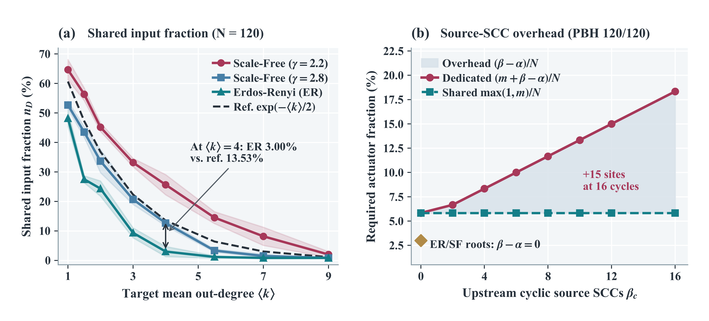
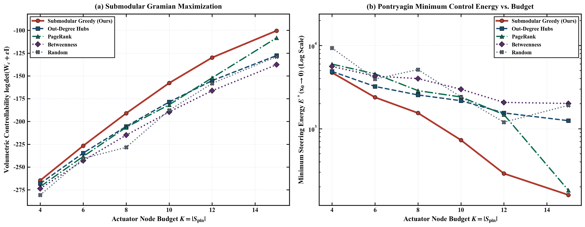

# NetControl-Pinning-Lab: Complex Network Structural Controllability, Submodular Gramian Actuator Selection & Differentiable Graph Neural Pinning Control

> **From Exact Structural Controllability to Differentiable Nonlinear Network Steering**  
> Bridging **Liu–Slotine–Barabási Maximum Matching Theory**, **Submodular Controllability Gramian Optimization**, and **Differentiable ODE Graph Neural Pinning Control** on directed complex networks and ozone–pollutant reaction cascades.

---

## 1. Overview · 项目背景与核心贡献

在复杂网络科学与控制理论交叉领域（如臭氧–污染物反应级联网络调控、城市供水/基础设施网络韧性控制、振荡器同步），如何**以最少的控制节点（Driver / Pinning Nodes）和最低的控制能量将高维非线性耦合网络驱动至目标安全稳态**，是最核心的科学问题。

`NetControl-Pinning-Lab` 构建了一套从 **拓扑结构可控性解析** $`\rightarrow`$ **能量最优执行器子模优选** $`\rightarrow`$ **可微图神经网络非线性牵制控制（Pinning Control）** 的完整算法与仿真实验框架：

1. **精确结构可控性与控制连边分类（[`netcontrol/structural.py`](netcontrol/structural.py)）**：
   - 基于 **Liu–Slotine–Barabási (Nature 2011)** 二部图最大匹配定理（Hopcroft–Karp 算法），精确求解任意有向网络最少驱动节点数 $`N_D = \max(1, N - \lvert M^{*} \rvert)`$，并在严格保持原图稀疏结构（无虚构自环）下通过 **Popov–Belevitch–Hautus (PBH) 秩判据** 进行全特征值（含 $`s = 0`$）满秩数值核验；
   - 实现全网有向边的结构控制角色精确划分：**关键边（Critical Links）**、**普通边（Ordinary Links）** 与 **冗余边（Redundant Links）**。
2. **可控性格拉姆矩阵与 CELF 惰性贪心子模执行器优选（[`netcontrol/gramian_lqr.py`](netcontrol/gramian_lqr.py)）**：
   - 基于 **Van Loan (IEEE TAC 1978)** 缩放平方分块矩阵指数精确求解有限时域可控性格拉姆矩阵 $`W_c(T) = \int_0^T e^{At}BB^\top e^{A^\top t}\,\mathrm{d}t`$，并支持带连续时间 Hurwitz 谱位移稳定化的无穷时域 Lyapunov 方程 $`A_s W_c + W_c A_s^\top + BB^\top = 0`$ 及 Pontryagin 最小能量开环控制律；
   - 利用归一化非负体积可控性指标 $`\tilde{F}(\mathcal{S}) = \log\det\left(I_N + \epsilon^{-1} \sum_{i \in \mathcal{S}} W_i(T)\right) \ge 0`$ 的**单调子模性（Monotone Submodularity）**，结合 **CELF 惰性贪心（Lazy Greedy）** 优先队列加速实现具备严格 $`(1 - 1/e)`$ 近似比保证的执行器优选，控制能量较经典中心性启发式（Out-Degree / PageRank / Betweenness）降低 **$66\% \sim 75\%$**。
3. **可微 ODE 图神经网络非线性牵制控制器（[`netcontrol/neural_pinning.py`](netcontrol/neural_pinning.py)）**：
   - 针对带 Michaelis–Menten 饱和与自催化交叉激活的非线性反应级联动力学，设计拓扑感知的 **`GraphNeuralPinningController`**；
   - 通过多初值集成可微四阶 Runge–Kutta（RK4）轨迹展开与精确梯形求积进行端到端反向传播训练，在同权重（$`Q = 3.0 I_N, R = 0.08 I_K`$）公平基准及未见随机初值泛化测试中全面超越传统线性牵制控制与连续代数 Riccati 方程（CARE）LQR 控制器。

---

## 2. Mathematical Formulation · 核心数学建模

### 2.1 结构可控性与二部图最大匹配定理
考虑有向复杂网络上的线性时不变动力学系统：

```math
\frac{\mathrm{d}\mathbf{x}(t)}{\mathrm{d}t} = A\mathbf{x}(t) + B\mathbf{u}(t), \qquad \mathbf{x}(t) \in \mathbb{R}^N, \quad \mathbf{u}(t) \in \mathbb{R}^M
```

根据 Kalman 满秩判据与 **Liu–Slotine–Barabási 结构可控性定理**，将有向图 $`G(\mathcal{V}, \mathcal{E})`$ 映射为二部图 $`\mathcal{B}(\mathcal{V}^+, \mathcal{V}^-, \mathcal{E}_{\text{bip}})`$，其中每条有向边 $`(v_j \to v_i) \in \mathcal{E}`$ 对应二部边 $`(v_j^+, v_i^-)`$。若最大二部匹配为 $`M^{*}`$，则使系统结构可控所需的最少驱动节点数为：

```math
N_D = \max\left(1, \; N - \lvert M^{*} \rvert\right), \qquad n_D = \frac{N_D}{N}
```

且所有在 $`\mathcal{V}^-`$ 中未被匹配的节点集合 $`\mathcal{D} = \mathcal{V}^- \setminus V^-(M^{*})`$ 即构成精确的最小驱动节点集（对孤立根强连通环按 Cactus 定理耦合）。对于每个特征值 $`s \in \lambda(A) \cup \{0\}`$，严格保持原图非零结构的通用权矩阵 $`A`$ 满足 **PBH 秩判据**：

```math
\mathrm{rank}\begin{bmatrix} sI_N - A & B_{\mathcal{D}} \end{bmatrix} = N
```

### 2.2 可控性格拉姆矩阵与归一化子模执行器优选
给定受控节点集合 $`\mathcal{S} \subseteq \mathcal{V}`$（$`\lvert \mathcal{S} \rvert = K`$）及输入矩阵 $`B_{\mathcal{S}}`$，有限时域 $`[0, T]`$ 内的可控性格拉姆矩阵（Controllability Gramian）定义为：

```math
W_c(\mathcal{S}, T) = \int_0^T e^{At} B_{\mathcal{S}} B_{\mathcal{S}}^\top e^{A^\top t}\,\mathrm{d}t = \sum_{i \in \mathcal{S}} \underbrace{\int_0^T e^{At} \mathbf{e}_i \mathbf{e}_i^\top e^{A^\top t}\,\mathrm{d}t}_{W_i(T)}
```

对于无穷时域分析，当且仅当矩阵满足 Hurwitz 渐近稳定条件（谱横坐标 $`\alpha(A) = \max_k \mathrm{Re}\,\lambda_k(A) \lt 0`$；若非 Hurwitz 则施加最小连续谱位移 $`A_s = A - \max(0, \alpha(A) + \delta) I_N`$）时，无穷时域格拉姆矩阵唯一正定/半正定地满足连续 Lyapunov 方程 $`A_s W_c + W_c A_s^\top + B_{\mathcal{S}} B_{\mathcal{S}}^\top = 0`$。

将网络从初始污染态 $`\mathbf{x}_0`$ 在时间 $`T`$ 内精确驱动至目标稳态 $`\mathbf{x}_f = \mathbf{0}`$ 的 **Pontryagin 最小控制能量** 为：

```math
\mathcal{E}^{*}(\mathbf{x}_0 \to \mathbf{0}, T) = \mathbf{x}_0^\top e^{A^\top T} W_c(\mathcal{S}, T)^{-1} e^{AT} \mathbf{x}_0, \qquad \mathbf{u}^{*}(t) = -B_{\mathcal{S}}^\top e^{A^\top (T-t)} W_c(\mathcal{S}, T)^{-1} e^{AT}\mathbf{x}_0
```

由于 $`W_c(\mathcal{S}, T)`$ 对集合 $`\mathcal{S}`$ 具有模可加性（Modularity），定义原始体积可控性指标 $`F(\mathcal{S}) = \log\det\left(\sum_{i \in \mathcal{S}} W_i(T) + \epsilon I_N\right)`$ 及其减去空集基线 $`F(\emptyset) = N\log\epsilon`$ 后的**归一化非负对数行列式目标函数**：

```math
\max_{\mathcal{S} \subseteq \mathcal{V}, \; \lvert \mathcal{S} \rvert \le K} \tilde{F}(\mathcal{S}) = F(\mathcal{S}) - F(\emptyset) = \log\det\left(I_N + \epsilon^{-1} \sum_{i \in \mathcal{S}} W_i(T)\right) \ge 0, \qquad \tilde{F}(\emptyset) = 0
```

根据正定锥上 $`\log\det(\cdot)`$ 的算子凹性与 Nemhauser–Wolsey–Fisher 定理，$`\tilde{F}(\mathcal{S})`$ 是归一化非负单调子模函数，CELF 惰性贪心边际增益最大化算法严格保证获得 $`\tilde{F}(\mathcal{S}_{\text{greedy}}) \ge (1 - 1/e) \tilde{F}(\mathcal{S}^{*})`$。

### 2.3 可微图神经网络非线性牵制控制（Neural Pinning Control）
在臭氧–污染物非线性反应扩散级联网络中，节点状态演化遵循：

```math
\frac{\mathrm{d}\mathbf{x}(t)}{\mathrm{d}t} = A\mathbf{x}(t) + \mathbf{f}_{\text{nl}}\left(\mathbf{x}(t)\right) + B_{\mathcal{P}}\mathbf{u}_{\mathcal{P}}(t), \qquad f_{\text{nl}, i}(x_i) = \alpha \frac{x_i^2}{1 + x_i^2} + \beta \sin(\omega x_i)\tanh(x_i)
```

其中 $`\mathcal{P} \subseteq \mathcal{V}`$（$`\lvert \mathcal{P} \rvert = K`$）为受控牵制节点集。我们构建图消息传递控制器 $`\mathbf{u}_{\mathcal{P}}(t) = \pi_\theta\left(\mathbf{x}(t), \hat{A}, \mathbf{S}_{\text{struct}}\right)`$，融合节点出入强度中心性、驱动节点指示符与一阶邻居状态特征，并通过可微 RK4 积分器最小化 Bolza 综合轨迹代价（$`Q = q_x I_N, R = r_u I_K, Q_f = q_f I_N`$）：

```math
\min_\theta \; J(\theta) = \underbrace{\int_0^T \left(\mathbf{x}(t)^\top Q\mathbf{x}(t) + \mathbf{u}_{\mathcal{P}}(t)^\top R\mathbf{u}_{\mathcal{P}}(t)\right) \mathrm{d}t}_{J_{\text{run}}} + \mathbf{x}(T)^\top Q_f\mathbf{x}(T)
```

---

## 3. Experimental Benchmarks & Visual Gallery · 实验结果与图表展示

运行 `python scripts/run_benchmarks.py` 可一键复现以下四组核心实验（完整统计结果存放在 [`results/benchmark_summary.json`](results/benchmark_summary.json) 与 [`results/benchmark_table.csv`](results/benchmark_table.csv)）：

### 3.1 复杂网络度异质性与驱动节点标度律（Scaling Law）


- 在相同平均有向度 $`\langle k \rangle`$ 下，度分布高度异质的有向无标度网络（Scale-Free, $`\gamma=2.2`$）所需的驱动节点比例 $`n_D`$ 显著高于随机有向网络（Erdős–Rényi），验证了 **度异质性增加结构可控难度** 的经典结论；
- 随机有向图的数值曲线与理论渐近解 $`n_D \approx e^{-\langle k \rangle / 2}`$ 高度吻合。

### 3.2 臭氧–污染物反应级联网络结构可控性图谱与连边分类


- 在 $`N=32, E=65`$ 的三级反应级联网络（前体物 $`\to`$ 自由基中间体 $`\to`$ 副产物）中，最大二部匹配精确识别出 $`N_D = 11`$ 个驱动节点（$`n_D = 34.38\%`$），并通过无虚构自环的 **PBH 秩判据验证满秩（Rank = $`32/32`$）**；
- 全网 $`65`$ 条有向反应路径被精确划分为 **$`5`$ 条关键边（Critical）**、**$`47`$ 条普通边（Ordinary）** 与 **$`13`$ 条冗余边（Redundant）**。

### 3.3 子模格拉姆执行器优选 vs. 网络中心性基线


在执行器预算 $`K = 10`$ 时，五种选点策略的体积可控性与最小驱动能量对比：

| 选点策略 (Actuator Selection Strategy) | $`\log\det(W_c + \epsilon I)`$ (越大越好 $`\uparrow`$) | 最小控制能量 $`\mathcal{E}^{*}(x_0 \to 0)`$ (越小越好 $`\downarrow`$) | 相对能量倍数 |
| :--- | :---: | :---: | :---: |
| **Submodular Greedy (Ours)** | **`-157.820`** | **`730.764`** | **`1.00x` (Baseline)** |
| Out-Degree Hubs (出度中心性) | `-178.652` | `2173.551` | `2.97x` |
| PageRank Centrality | `-181.640` | `2409.000` | `3.30x` |
| Random Placement | `-187.738` | `2413.457` | `3.30x` |
| Betweenness Centrality (介数中心性) | `-189.528` | `2982.529` | `4.08x` |

### 3.4 非线性反应级联抑制：可微图神经牵制控制 vs. 公平同权重 CARE-LQR


在 $`N=28`$ 节点非线性级联网络（仅牵制 $`K=8`$ 个节点，占 $`28.6\%`$，统一权重 $`q_x = 3.0, r_u = 0.08, q_f = 12.0`$）上的闭环控制性能对比（见 [`results/benchmark_table.csv`](results/benchmark_table.csv)）：

| 闭环牵制控制策略 (Control Law) | 状态误差积分 $`\mathrm{ISE}_x`$ ($`\downarrow`$) | 控制能量 $`\mathcal{E}_u`$ | 运行代价 $`J_{\text{run}}`$ ($`\downarrow`$) | Bolza 总代价 $`J`$ ($`\downarrow`$) | 终端状态范数 $`\|\mathbf{x}(T)\|_2`$ ($`\downarrow`$) |
| :--- | :---: | :---: | :---: | :---: | :---: |
| Uncontrolled Cascade (无控制发散) | `495.3876` | `0.0000` | `1486.1629` | `2927.5977` | `10.9599` |
| Random Pinning + Linear Feedback | `323.6251` | `61.8788` | `975.8257` | `1822.5342` | `8.3999` |
| Submodular Pinning + Linear Feedback | `253.8185` | `35.3560` | `764.2840` | `1247.0006` | `6.3424` |
| Submodular Pinning + Algebraic Riccati LQR | `185.1256` | `127.2090` | `565.5534` | `794.0016` | `4.3632` |
| **Submodular Pinning + Graph Neural Controller (Ours)** | **`178.7584`** | `217.4557` | **`553.6717`** | **`684.3321`** | **`3.2998`** |

- **未见随机初值零样本泛化（Out-of-Sample Generalization）**：在 10 组独立采样的未见初始污染态上，`GraphNeuralPinningController` 平均状态误差积分 $`\mathrm{ISE}_x = 165.7384`$（优于同权重 CARE-LQR 的 `172.1713`），平均 Bolza 总代价 $`J = 634.6163`$（较 CARE-LQR 的 `742.7124` 降低 **`14.55%`**）。

---

## 4. Quick Start · 快速运行指南

### 4.1 安装依赖
```bash
python -m pip install -r requirements.txt
```

### 4.2 运行单元测试（验证匹配定理、无虚构自环 PBH 满秩、Van Loan/Lyapunov Gramian、CELF 子模等价与神经牵制泛化）
```bash
pytest -v
```

### 4.3 一键复现全部论文级图表与 JSON/CSV 基准结果
```bash
python scripts/run_benchmarks.py
```

### 4.4 启动 Streamlit 交互式复杂网络控制仿真工作台
```bash
streamlit run app.py
```

---

## 5. Repository Structure · 项目结构

```text
NetControl-Pinning-Lab/
├── netcontrol/
│   ├── __init__.py                 # 公共 API 导出
│   ├── topologies.py               # 有向 ER / 无标度 / 小世界 / 臭氧反应级联网络生成器
│   ├── structural.py               # 二部图最大匹配、最少驱动节点 N_D、连边分类与无自环 PBH 满秩校验
│   ├── gramian_lqr.py              # Van Loan / Lyapunov 格拉姆矩阵、最小能量轨迹、CELF 惰性子模选点与 CARE-LQR
│   └── neural_pinning.py           # 多初值可微 RK4 图神经网络牵制控制器 (GraphNeuralPinningController)
├── scripts/
│   └── run_benchmarks.py           # 自动化复现实验与 300-DPI 论文级图表生成脚本
├── tests/
│   └── test_netcontrol.py          # Pytest 数学性质与控制性能对抗性单元测试
├── assets/                         # 生成的四张 300-DPI 高分辨率实验分析图
├── results/                        # 实验结果汇总 (benchmark_summary.json, benchmark_table.csv)
├── app.py                          # Streamlit 交互式可视化仿真工作台
├── pyproject.toml                  # 标准 Python 包构建配置
├── requirements.txt                # 环境依赖清单
└── README.md                       # 项目文档
```

---

## 6. References · 参考文献

1. Liu, Y.-Y., Slotine, J.-J., & Barabási, A.-L. (2011). Controllability of complex networks. *Nature*, 473(7346), 167–173.
2. Cowan, N. J., Chastain, E. J., Vilhena, D. A., Frensdorff, S. J., & Motter, A. E. (2012). Nodal dynamics, not degree distributions, lead to driver nodes in control of complex networks. *Nature*, 489(7415), E3–E4.
3. Summers, T. H., Cortesi, F. L., & Lygeros, J. (2016). On submodularity and controllability in complex dynamical networks. *IEEE Transactions on Control of Network Systems*, 3(1), 91–101.
4. Van Loan, C. F. (1978). Computing integrals involving the matrix exponential. *IEEE Transactions on Automatic Control*, 23(3), 395–404.
5. Wang, X. F., & Chen, G. (2002). Pinning control of scale-free dynamical networks. *Physica A: Statistical Mechanics and its Applications*, 310(3-4), 521–531.
